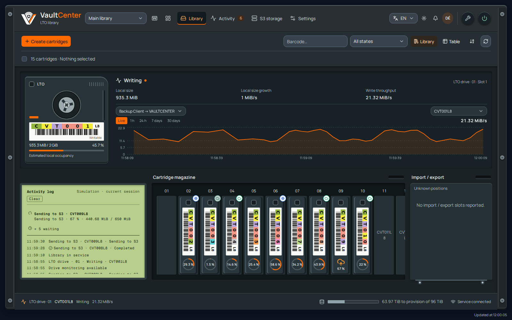
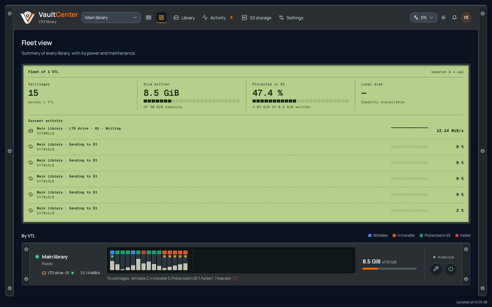
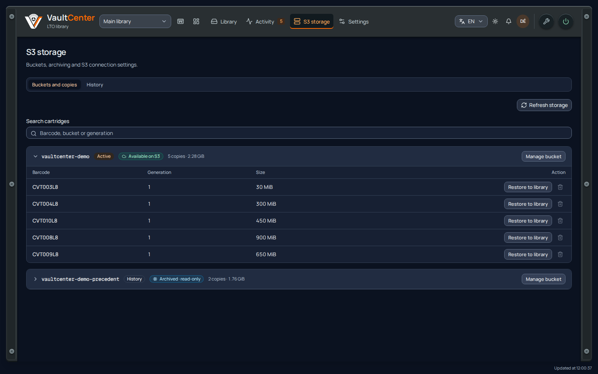
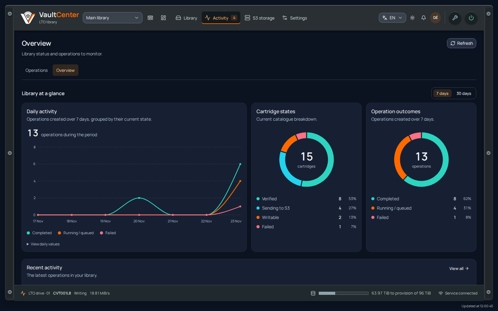
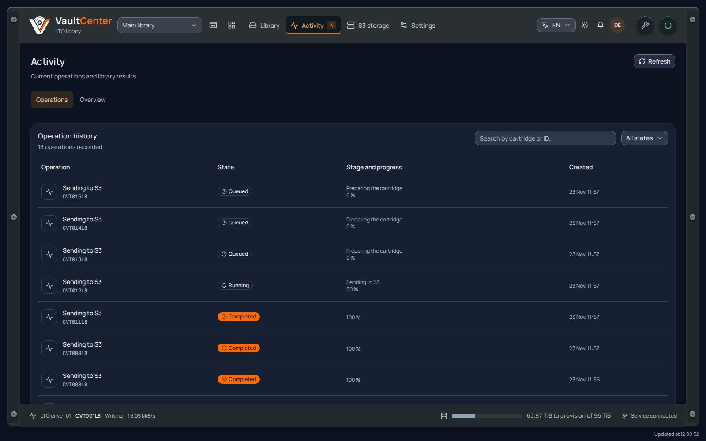
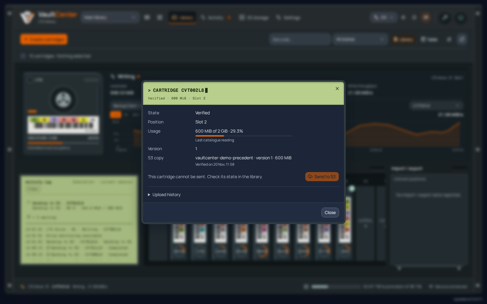
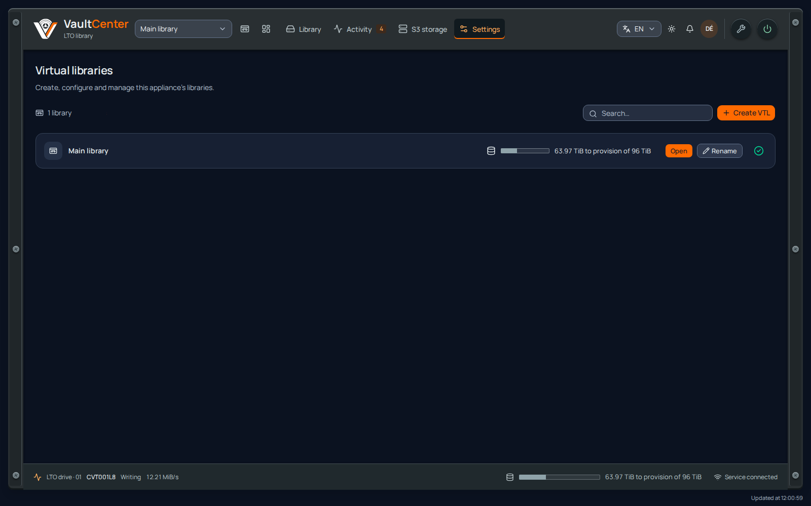
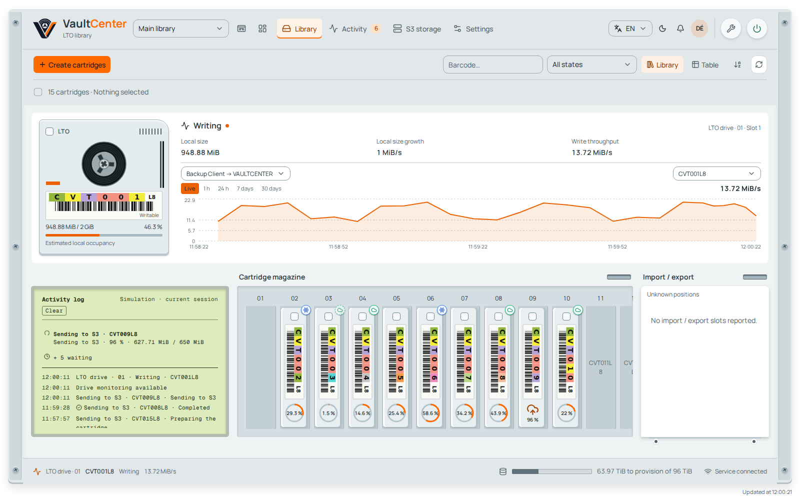
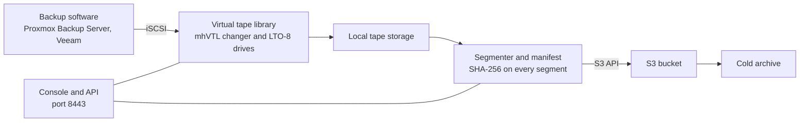

<p align="center">
  <picture>
    <source media="(prefers-color-scheme: dark)" srcset="ui/public/brand/vaultcenter-logo-horizontal-dark.svg">
    
  </picture>
</p>

<p align="center">
  <strong>A virtual tape library that sends your backups to S3 cold storage</strong>
</p>

<p align="center">
  
  
  
  
</p>

<p align="center">
  <a href="docs/install.md"><b>Installation</b></a> · <a href="docs/operator.md"><b>Operator guide</b></a> · <a href="docs/architecture.md"><b>Architecture</b></a> · <a href="CHANGELOG.md"><b>Changelog</b></a>
</p>

---

## Overview

<p align="center">
  <strong>VaultCenter</strong> presents a tape library to your backup software, keeps the tapes on fast local disk, and copies each one to S3-compatible object storage, where it can be moved to cold archive and brought back when needed. Your backup software keeps writing to tape; VaultCenter takes care of where the tape really lives.
</p>

<p align="center">
  
</p>

---

## Requirements

- **Host**: a dedicated Debian 12 or 13 machine, amd64, with systemd. A virtual machine is fine; a container is not
- **Sizing**: 2 CPU, 4 GiB RAM and 20 GiB free under `/var/lib/docker`, plus the disk space your tapes will occupy
- **Ports**: 8443 inbound for the console and the API, 3260 inbound for iSCSI
- **Network**: outbound HTTPS to `ghcr.io`, `deb.debian.org` and `download.docker.com`
- **Kernel**: Secure Boot disabled, because the installer builds the mhVTL kernel module with DKMS

The installer checks all of this before it changes anything and lists every cause of refusal at once.

---

## Quick Start

```bash
curl -fsSL https://vaultcenter.io/install | sudo bash
```

The installer sets up Docker, the mhVTL kernel module, the host services and the appliance container. When it finishes, it prints the address of the console (`https://your-server:8443`) and the password of the first administrator, shown once.

To install a specific version, pass options after `-s --`:

```bash
curl -fsSL https://vaultcenter.io/install | sudo bash -s -- --version X.Y.Z
```

The full procedure, the options and what the script changes on the host are in the [installation guide](docs/install.md).

---

## Features

| Area | What VaultCenter does |
|---|---|
| **Tape library** | Exposes a media changer and LTO-8 drives over iSCSI, built on mhVTL and `tgt` |
| **Backup software** | Works with Proxmox Backup Server and Veeam, with a guided connection for each |
| **Several libraries** | Runs more than one library on the same appliance, each with its own cartridges, local folder and S3 destination |
| **Cartridges** | Creates and deletes cartridges, alone or in batches, with a check of the local space they will need |
| **S3 copies** | Sends each tape to S3 in verified segments, with resumable transfers and SHA-256 integrity |
| **Cold archive** | Archives a bucket to OVHcloud Cold Archive and recalls it on demand |
| **Restore** | Brings a tape back from S3 into the library, from the current bucket or an earlier one |
| **Bucket rotation** | Opens a new bucket every month on a schedule and keeps the previous ones readable |
| **Monitoring** | Live drive throughput, 30 days of history, one curve per tape or all tapes summed, local storage gauge |
| **Activity** | Operations list, daily overview, notification bell and e-mail notifications |
| **Bandwidth** | Limits tape writes and S3 transfers separately |
| **Maintenance** | Maintenance mode and power control of each library from the console |
| **Access** | Local accounts with roles, and OIDC single sign-on |
| **Interface** | English and French, light and dark themes, usable on a phone |
| **Updates** | The same command updates the appliance, with a backup first and an automatic rollback on failure |

---

## Screenshots

<table>
  <tr>
    <td width="50%" align="center"><br><sub><b>Fleet view</b></sub></td>
    <td width="50%" align="center"><br><sub><b>S3 buckets and copies</b></sub></td>
  </tr>
  <tr>
    <td width="50%" align="center"><br><sub><b>Activity overview</b></sub></td>
    <td width="50%" align="center"><br><sub><b>Operations</b></sub></td>
  </tr>
  <tr>
    <td width="50%" align="center"><br><sub><b>Cartridge details</b></sub></td>
    <td width="50%" align="center"><br><sub><b>Virtual libraries</b></sub></td>
  </tr>
  <tr>
    <td colspan="2" align="center"><br><sub><b>Library view, light theme</b></sub></td>
  </tr>
</table>

<p align="center"><sub>Screenshots come from the built-in demonstration mode, which simulates a library and its S3 transfers.</sub></p>

---

## Architecture



- **One appliance container** holds the API, the web console, the CLI, the S3 worker, mhVTL userspace and the `tgt` iSCSI target
- **The host** only carries the mhVTL kernel module, built by DKMS so that it follows kernel upgrades, and a small storage service
- **The control plane is written in Rust**, with its catalogue in SQLite; the console is a static Next.js export served by the same process
- **Copies are immutable segments** checked against their SHA-256 during transfer; a manifest is published only once every segment is verified

More in [architecture](docs/architecture.md) and [transfer integrity and resume](docs/s3-exports.md).

---

## Upgrade

Run the installation command again on the appliance:

```bash
curl -fsSL https://vaultcenter.io/install | sudo bash
```

The script detects the installed appliance, refuses while a backup or a transfer is running, enters maintenance, backs up the catalogue and the configuration, pulls the new image by digest and checks the health of the appliance. If anything fails, it restores the previous image and database by itself. See [updating](docs/install.md).

---

## Documentation

| Topic | Guide |
|---|---|
| Install and update | [install.md](docs/install.md) |
| Day-to-day operation | [operator.md](docs/operator.md) |
| Connect Proxmox Backup Server | [pbs-connection.md](docs/pbs-connection.md) |
| Connect Veeam | [veeam.md](docs/veeam.md) |
| S3 settings and bucket rotation | [s3-settings.md](docs/s3-settings.md) |
| Cold archive and recall | [archive.md](docs/archive.md) |
| Restore a tape from S3 | [restoration.md](docs/restoration.md) |
| Monthly buckets and cartridge recovery | [s3-recovery.md](docs/s3-recovery.md) |
| Accounts and single sign-on | [authentication.md](docs/authentication.md) |
| Notifications | [notifications.md](docs/notifications.md) |
| Manual Docker deployment and internals | [reference.md](docs/reference.md) |
| Releasing a version | [release.md](docs/release.md) |

---

## Build from source

```bash
# Control plane, CLI and worker
cargo build --release --locked --workspace

# Web console
cd ui && npm ci && npm run build

# Local demonstration, no appliance needed
cd ui && npm run dev:demo
```

The demonstration serves the console on `http://localhost:3000` with a simulated library. The appliance image is built by the `Dockerfile` at the root of the repository; see the [reference](docs/reference.md) for the manual deployment.

---

## Project status

VaultCenter is at an early stage: version 0.2. Existing `cold-vtl` executable names, crate names, environment variables and service names are kept for compatibility with installed appliances.

The installer and the updater are covered by automated tests; their known limitations on real machines are listed at the end of the [installation guide](docs/install.md).

## License

The distribution license has not been chosen yet. VaultCenter builds on mhVTL, which is GPL software, and the choice depends on how the two are combined.
