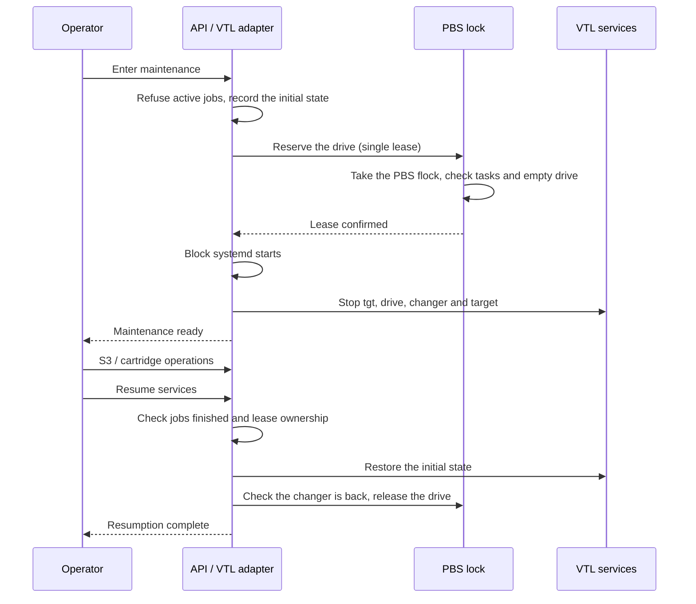

# Automated PBS/mhVTL maintenance

The commands are built into **Tapes and drives** (`#media`), through the **Maintenance** button next to **Power**, in the library header. It opens the enter/resume commands, the diagnostics and the history. Old `#maintenance` links open this window while keeping the selected VTL.

The console's **Maintenance** window and `cold-vtl maintenance` coordinate
PBS access to the drive and the VTL services. This maintenance is an
explicit window: the operator enters maintenance, performs their operations,
then resumes the services once the jobs are finished.

[Reintegration of a restored cartridge](reintegration.md) uses this same
lock and handles entering and leaving automatically. Its log blocks the ordinary
resumption after an interruption; the return to the previous cartridge is
then shown directly on this page. Tracking and rollback of the
other reintegrations remain available from **Cartridges → S3 copies →
PBS reintegration**. The intervention history expands at the bottom of the
Maintenance page.

## Usage

1. Finish the PBS tasks and unload the drive in PBS.
2. In the VTL, open **Maintenance → Enter maintenance**.
3. Wait for **In maintenance** and **Media operations: allowed**.
4. Seal, export or synchronise the generations from Cartridges.
5. Wait for the jobs to finish, then **Resume service**.

An administrator account is required. Viewers have access to the state and
the history, without being able to perform a transition. The checks are also
enforced on the API side, with the usual CSRF protection.

In **Cartridges**, the chassis **Power** button opens a confirmation
to stop the library or bring it back into service. It uses these same maintenance commands:
it stops the drive, the changer and iSCSI access, not the VM or the console.
A copy, a cartridge move or a media still loaded blocks the stop.
The jobs are re-read before the actual confirmation, then the controller reserves
the PBS drive and checks the tasks before touching the services. A
partial state, a pending reintegration or an unconfirmed resumption sends you back to
Maintenance; the button offers no forced stop. The "Stopped" state is
shown only once the stop of all services and the ready maintenance are
confirmed. In the local demonstration, this cycle is simulated without touching any service.

```bash
# After CLI sign-in and configuration of the HTTPS URL / CA.
cold-vtl maintenance status
cold-vtl maintenance enter
cold-vtl media reconcile CVT001L8
cold-vtl jobs watch JOB_ID
cold-vtl maintenance leave
cold-vtl maintenance events
```

Resumption is always explicit, including after a failed job: check
its result before putting PBS back into service. An active job, whatever
the cartridge, blocks both entering and leaving maintenance. A worker still
present after a daemon restart also blocks these transitions.

## Sequence and guarantees



The PBS adapter uses the **same flock as PBS**, whose path is computed
from the configured drive path with `systemd-escape --path`:
`/run/proxmox-backup/drive-lock/<escaped path>`. A real test checks that a
`proxmox-tape status` command fails on this lock when it is reserved.
The mechanism is described in the
[official PBS driver code](https://github.com/proxmox/proxmox-backup/blob/master/src/tape/drive/mod.rs).

The task check is deliberately conservative: any active PBS task
blocks a new entry. Tape tasks scheduled after the
reservation may wait for the drive or fail according to their own timeout;
they do not get access to the drive during the lease. Schedules
are not modified. The changer is queried without cache to refuse a
loaded drive before the stop.

The services are stopped in the order `tgt.service`, `vtltape@11.service`,
`vtllibrary@10.service`, `mhvtl.target`. A persistent file blocks their
restart through systemd conditions. The PBS lock is kept during
resumption, until the changer is back over iSCSI.

Sealing, export and reconciliation require a `maintenance` state, the services
stopped, the block present and the lease confirmed on the PBS side. These checks
replace the simple manual stop check when the adapter is configured.
Restores to a separate folder remain possible outside maintenance;
their jobs nevertheless block a service transition while they run.

## Persistence and incidents

On the VTL:

- `/var/lib/cold-vtl/maintenance-state.json`: state, lease, actor, date,
  initial services and last error; written atomically with fsync.
- `/var/lib/cold-vtl/maintenance-block`: prevents the services from starting,
  including after an appliance reboot.
- `/var/lib/cold-vtl/maintenance-controller.lock`: serialises transitions
  even if an HTTP request times out or the daemon restarts.
- SQLite `maintenance_events`, migration `0004_maintenance.sql`: history
  of transitions with user, date, success or error.

On PBS:

- `/var/lib/cold-vtl-guard/lease.json`: persistent lease.
- `cold-vtl-guard.service`: holds the flock descriptor, takes the lease back
  after a restart and orders itself before the PBS services at boot.
- `/run/cold-vtl-guard/control.sock`: protected local socket.

An error does not release the drive automatically. After a partial
stop, the operator can use **Resume service** once the problem is resolved.
If a resumption fails after the restart has begun, the adapter restores the
block and tries to stop the services, keeps the lease and shows the error.
The actual states of the services remain visible if this stop itself fails.

If PBS is unreachable, local sign-in to the VTL remains
possible, but operations that require its lease, and resumption, are refused.
A lost, different or unconfirmable lease requires root
intervention; there is no "force" button that would bypass this check.

After an interrupted transition (`entering` / `leaving`), check that no
controller is still running, then use resumption. Do not remove the
block file or the lease by hand during a transfer.

## PBS guard and SSH access

This version targets **one drive and one changer** per VTL, coordinated with
one PBS server. Entering from a partial state of the
services is refused: they must be all active or all inactive, and the
PBS changer must remain reachable to check that the drive is empty. Partial
states must be repaired before the reservation.

The SSH key is dedicated:

- private key on the VTL: `/etc/cold-vtl/maintenance/id_ed25519` (0600);
- PBS host key pinned in `/etc/cold-vtl/maintenance/known_hosts`;
- PBS authorisation limited to the VTL's address and to the forced command
  `/usr/local/libexec/cold-vtl-pbs-guard ssh`, with `restrict`;
- protocol limited to `status`, `acquire`, `verify`, `release` and a validated lease
  identifier; no user argument is executed by a shell.

The configuration `/etc/cold-vtl-guard.json` contains the drive path, the
changer name and the SHA-256 of `/etc/proxmox-backup/tape.cfg`. A change
in the PBS configuration blocks entry until this fingerprint is checked and then explicitly
updated. The SSH secret is never sent to the GUI.

This mechanism coordinates PBS, the console and the configured systemd services.
It does not replace hardware SCSI protection and cannot prevent a
root administrator from bypassing the adapters, manipulating the
devices directly or modifying the spool. Manual worker commands
remain the operator's responsibility.

## Installation

1. Install `deploy/pbs/maintenance-guard.py` as
   `/usr/local/libexec/cold-vtl-pbs-guard` (0755), its systemd service and the
   configuration above. Enable `cold-vtl-guard.service`.
2. Install `deploy/cold-vtl/maintenance-controller.py` as
   `/usr/local/libexec/cold-vtl-maintenance` (0755), its configuration and the dedicated
   key under `/etc/cold-vtl`. Also install the modules
   `deploy/cold-vtl/cartridge_batches.py` and `deploy/cold-vtl/cartridge_deletion.py`
   in `/usr/local/libexec/` (0644); they check incomplete creation batches and
   deletions before the services are resumed.
3. Install `maintenance-condition.conf` as a drop-in on each of the four
   VTL services listed above, then `systemctl daemon-reload`.
4. Configure `COLD_VTL_MAINTENANCE_HELPER=/usr/local/libexec/cold-vtl-maintenance`
   in the daemon and deploy the new binaries/GUI.

Example `/etc/cold-vtl/maintenance.json`:

```json
{
  "pbs": "root@pbs.example.net",
  "key_file": "/etc/cold-vtl/maintenance/id_ed25519",
  "known_hosts": "/etc/cold-vtl/maintenance/known_hosts"
}
```

Checks: `python3 -m unittest discover -s deploy/tests -v`, Rust tests,
Clippy, Next build and the restore regression.
